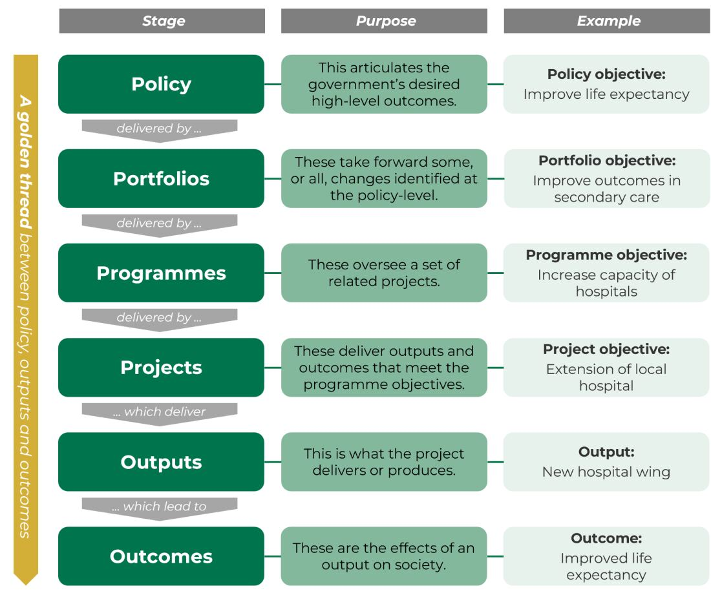
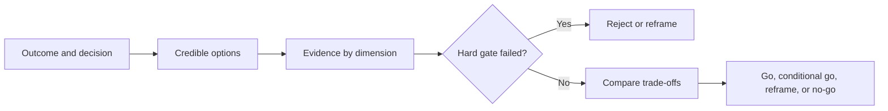

# Feasibility as a Decision

## Start with the Decision, Not the Document

A feasibility analysis asks whether a proposal is achievable and worth taking
forward under real constraints. Its purpose is not to defend an idea that has
already won support. It gives decision makers enough evidence to choose among
credible options before a larger commitment is made.

A useful analysis begins with a decision question:

> Should we proceed with this option, under which conditions, or should we
> pursue another way to achieve the outcome?

The answer may be:

- **Go:** evidence supports proceeding within the stated scope.
- **Conditional go:** proceed only after named conditions or experiments are
  satisfied.
- **Reframe:** the outcome matters, but the proposed solution or scope should
  change.
- **No-go:** a hard constraint, weak value case, unacceptable risk, or better
  alternative makes the proposal unsuitable.

A no-go decision can be valuable. It prevents avoidable cost and redirects
attention toward a better option.

## Compare Options, Including Business as Usual

Feasibility is relative. A proposal may be technically possible and still be
worse than buying an existing service, changing a process, using simple rules,
or continuing with current operations.

Compare at least:

1. the proposed option;
2. one materially simpler alternative; and
3. **business as usual**, meaning what is likely to happen without the proposed
   intervention.

HM Treasury's Green Book recommends generating and documenting alternatives
before selecting a preferred option. It also treats business as usual as a
benchmark with its own costs, benefits, and risks.

*Projects produce outputs that contribute to outcomes; they should remain
connected to the wider objective that justified the work.*

Source: [HM Treasury, The Green Book 2026, Figure 2](https://www.gov.uk/government/publications/the-green-book-appraisal-and-evaluation-in-central-government/the-green-book-2026), available under the [Open Government Licence 3.0](https://www.nationalarchives.gov.uk/doc/open-government-licence/version/3/).

## Core Feasibility Dimensions

The original course material uses five classic dimensions. Treat them as
connected perspectives, not independent checkboxes.

| Dimension | Decision question | Example evidence |
|---|---|---|
| Strategic and market | Does this solve a meaningful problem and support the organisation's goals? | User research, demand signals, strategic objectives, option comparison. |
| Economic | Are expected benefits worth the full lifecycle cost? | Cost ranges, benefit assumptions, funding constraints, sensitivity analysis. |
| Technical | Can the required capability be built or obtained? | Architecture review, prototypes, vendor evidence, specialist assessment. |
| Operational | Can the organisation run, support, and change it? | Skills, ownership, support model, process fit, monitoring capability. |
| Legal and compliance | Can it operate within applicable obligations? | Legal review, data protection assessment, contracts, sector requirements. |
| Scheduling and resources | Can it be delivered with realistic capacity and dependencies? | Resource availability, dependency evidence, comparable work, delivery ranges. |

Environmental and social impacts should also be considered where material.
The depth of analysis should be proportionate to the proposal's cost,
complexity, novelty, and risk.

## Evidence, Assumptions, and Confidence

Do not give every statement the same status.

| Status | Meaning | Example |
|---|---|---|
| Fact | Verified and traceable information | The current contract expires in November. |
| Estimate | A bounded prediction with a method | Migration is likely to require 4-7 specialist weeks based on two comparable projects. |
| Assumption | Something believed for planning purposes | The supplier will expose the required export API. |
| Constraint | A limit the option must respect | Personal data must remain in the approved region. |
| Risk | An uncertain event that could affect the outcome | Poor historical labels may delay evaluation. |
| Unknown | Important information that has not been established | Peak concurrent usage is not measured. |

Add a confidence level and a next validation action to important claims. A
precise-looking score without evidence creates false confidence.

## Hard Gates and Trade-offs

Some criteria are **gates**: an option cannot proceed unless they are met. A
legal prohibition, unavailable critical data, or unacceptable safety failure
may be a hard gate. Other criteria involve trade-offs, such as higher operating
cost in exchange for faster delivery.

Separate these before scoring options. Otherwise, a high average score can hide
one fatal weakness.

## Check Your Understanding

1. Why should business as usual appear in an option comparison?
2. What is the difference between a constraint and a risk?
3. When is a conditional go more honest than a go decision?

Show solution

1. It provides a realistic benchmark and exposes the costs and risks of not
   changing, instead of making the proposal look valuable in isolation.
2. A constraint is a limit that already applies; a risk is an uncertain event
   that may affect the outcome.
3. Use conditional go when the direction appears promising but critical
   evidence, approvals, experiments, or capabilities must be secured first.

## References

- [HM Treasury: The Green Book 2026](https://www.gov.uk/government/publications/the-green-book-appraisal-and-evaluation-in-central-government/the-green-book-2026)
- [GOV.UK: Stage 5, Options Appraisal](https://www.gov.uk/government/publications/libraries-alternative-delivery-models-toolkit/stage-5-options-appraisal)
