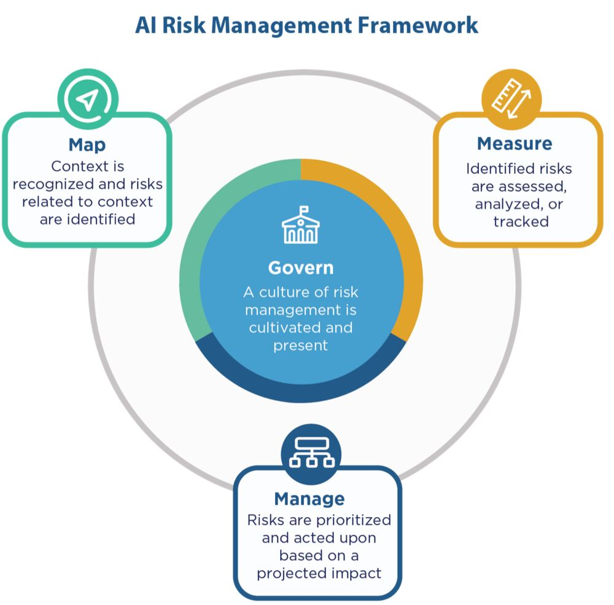
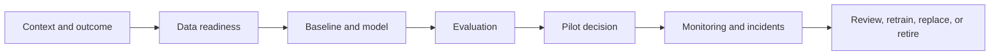

# AI and Data Product Feasibility

## AI Adds Dependencies, Not Automatic Value

An AI feature must pass the same business and delivery tests as any other
product. It also depends on data, evaluation, model behaviour, infrastructure,
governance, and ongoing monitoring. A successful demo proves very little about
production feasibility.

Begin with two questions:

1. Does the user or business outcome justify intervention?
2. Is AI materially better than a deterministic rule, search, process change,
   or existing product?

If the second answer is unclear, compare an AI option with a non-AI baseline.

## AI-Specific Feasibility Dimensions

| Dimension | Questions to investigate |
|---|---|
| Data | Is the required data available, permitted, representative, current, and reliable? How will it be collected and maintained? |
| Model | Is there enough signal to meet the required quality? What baseline and evaluation set will be used? |
| System | Can latency, availability, security, integration, and scale requirements be met? |
| Safety and fairness | Who could be harmed? What failure modes, bias, misuse, or over-reliance are plausible? |
| Legal and privacy | Is the data use lawful? Which AI Act, GDPR, intellectual-property, or sector obligations apply? |
| Human oversight | Which decisions need review, appeal, escalation, or a safe fallback? |
| Operations | Who monitors quality, incidents, drift, cost, vendors, and model changes after launch? |
| Adoption | Will people understand, trust, and use the capability in the intended workflow? |
| Sustainability | What are the energy, compute, storage, and replacement costs across the lifecycle? |

These dimensions interact. A larger model may improve one quality measure while
increasing latency, cost, environmental impact, and vendor dependence.

*The NIST AI RMF connects governance with continuous mapping, measurement, and
management of AI risks.*

Source: [NIST AI Risk Management Framework Core, Figure 5](https://airc.nist.gov/airmf-resources/airmf/5-sec-core/).

## Define Evidence Before Claiming Feasibility

Replace vague claims with testable evidence plans.

| Weak claim | Better feasibility question | Useful evidence |
|---|---|---|
| "We have lots of data." | Do we have permitted examples that represent the intended population and edge cases? | Data profile, provenance, consent, missingness, subgroup coverage. |
| "The model is accurate." | Does it beat the baseline on metrics connected to user harm and value? | Evaluation set, baseline comparison, error analysis, confidence intervals. |
| "The API is fast." | Does end-to-end latency meet the user journey under expected load? | Load test, latency distribution, timeout and fallback behaviour. |
| "Users will trust it." | Can users understand limitations and recover from errors? | Usability test, comprehension evidence, appeal and override test. |
| "The vendor is compliant." | Do contracts, data flows, controls, and deployment choices meet our obligations? | DPA, architecture, retention rules, legal and security review. |

An expert opinion can guide the next question. It is not the same as measured
evidence from the intended environment.

## Define Minimum Acceptable Performance

An average model score is not a product requirement. Define:

- the baseline to beat;
- the metric and evaluation population;
- critical error types and their costs;
- acceptable thresholds for key segments;
- latency, availability, and cost limits;
- fallback behaviour when confidence is low; and
- who can stop or override the system.

The threshold depends on the decision context. Suggesting a playlist and
screening a medical condition cannot share the same tolerance for error.

## Think Across the Lifecycle

Feasibility includes the ability to maintain or retire the system. If no owner,
budget, monitoring process, or safe shutdown path exists, the product is not
operationally feasible even when the initial model works.

## Check Your Understanding

1. Why should an AI option be compared with a non-AI baseline?
2. Why is a successful prototype insufficient evidence for production?
3. What makes an evaluation metric decision-relevant?

Show solution

1. The simpler option may deliver the outcome with lower cost, risk, and
   operational burden.
2. A prototype may use clean samples and light traffic while avoiding security,
   integration, monitoring, edge cases, and lifecycle costs.
3. It measures performance on the intended population and connects important
   error types to user value, harm, and an explicit acceptance threshold.

## References

- [NIST: AI Risk Management Framework Core](https://airc.nist.gov/airmf-resources/airmf/5-sec-core/)
- [NIST: AI RMF Generative AI Profile](https://www.nist.gov/publications/artificial-intelligence-risk-management-framework-generative-artificial-intelligence)
- [European Commission: AI Act](https://digital-strategy.ec.europa.eu/en/policies/regulatory-framework-ai)
