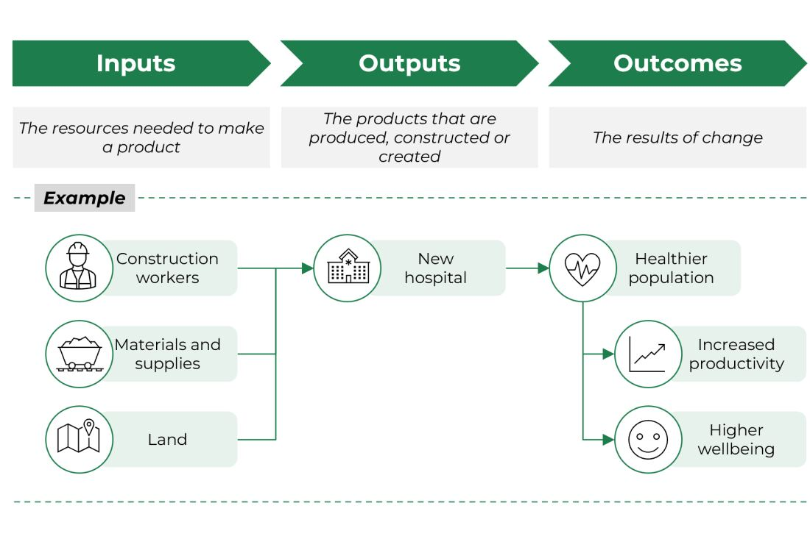
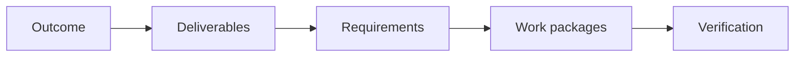

# From Outcomes to Deliverables

## A Feasible Direction Still Needs a Defined Scope

A positive feasibility decision does not create a project plan automatically.
The team must translate the intended outcome into tangible deliverables and
requirements before decomposing the work.

Keep these concepts separate:

| Concept | Main question | Example |
|---|---|---|
| Outcome | What change should occur? | Support colleagues find approved policy information more reliably. |
| Output or deliverable | What verifiable result must exist? | Search service, access-control integration, evaluation report. |
| Functional requirement | What must the product do? | Show the source used for each answer. |
| Non-functional requirement | How well or under which constraint must it work? | Return results within the agreed latency threshold. |
| Work package | What bounded scope can be owned and controlled? | Evaluation dataset and benchmark report. |
| Activity | What action produces a deliverable? | Review and label representative queries. |
| Milestone | What important state or decision has been reached? | Pilot readiness approved. |

User stories describe value from a user perspective. A WBS describes the total
project scope, including work that may not appear naturally as a user story:
security review, migration, evaluation, documentation, training, governance,
monitoring, and project management.

## Build a Traceable Chain

*A theory of change separates what a project uses and produces from the
shorter- and longer-term outcomes it intends to influence.*

Source: [HM Treasury, The Green Book 2026, Figure 3](https://www.gov.uk/government/publications/the-green-book-appraisal-and-evaluation-in-central-government/the-green-book-2026), available under the [Open Government Licence 3.0](https://www.nationalarchives.gov.uk/doc/open-government-licence/version/3/).

Use a simple chain to test scope:

Each major deliverable should support an outcome. Each requirement should be
covered by a deliverable or work package. Each work package should have a way
to verify completion.

## Deliverables Are Nouns, Activities Are Verbs

Compare:

| Activity wording | Deliverable wording |
|---|---|
| Design the evaluation | Approved evaluation plan |
| Integrate access control | Access-control integration |
| Test the fallback | Fallback test report |
| Train support colleagues | Support training package and attendance record |

Deliverable wording makes completion easier to verify and keeps the WBS focused
on scope. Activities can be derived later when building a schedule or backlog.

## Include the Whole Product, Not Only the Interface

AI and data teams often underestimate enabling and operational deliverables.
Check for:

- user experience and accessibility;
- data access, quality, lineage, and retention;
- model or rules, baselines, and evaluation;
- integrations, identity, permissions, and security;
- monitoring, incident response, and fallback behaviour;
- legal, privacy, safety, and governance evidence;
- documentation, training, support, and change management;
- migration, rollout, rollback, and retirement; and
- project governance and decision records.

Do not add every item automatically. Include what is required by the approved
scope and document deliberate exclusions.

## Requirements Are Not Yet a WBS

A requirements list describes expected behaviour and constraints. It does not
show all project deliverables or their hierarchy. A backlog organizes product
work for iterative delivery. It does not necessarily represent 100% of project
scope. A WBS creates a scope baseline from which activities, estimates,
ownership, and schedules can later be developed.

The artifacts should connect, not collapse into one another.

## Check Your Understanding

1. Why might a security review belong in the WBS but not fit naturally as a
   user story?
2. Is "run usability tests" a deliverable or an activity?
3. What does traceability reveal when a requirement has no work package?

Show solution

1. It is necessary project scope even though it does not directly express a
   user-facing capability.
2. It is an activity. The deliverable could be a usability test report with
   findings and an approved decision.
3. The scope may be incomplete because no defined work will satisfy or verify
   that requirement.

## References

- [HM Treasury: The Green Book 2026](https://www.gov.uk/government/publications/the-green-book-appraisal-and-evaluation-in-central-government/the-green-book-2026)
- [PMI: Developing and Elaborating Effective WBS](https://www.pmi.org/learning/library/developing-elaborating-work-breakdown-structures-7241)
- [Atlassian: Epics, Stories, Themes, and Initiatives](https://www.atlassian.com/agile/project-management/epics-stories-themes)
