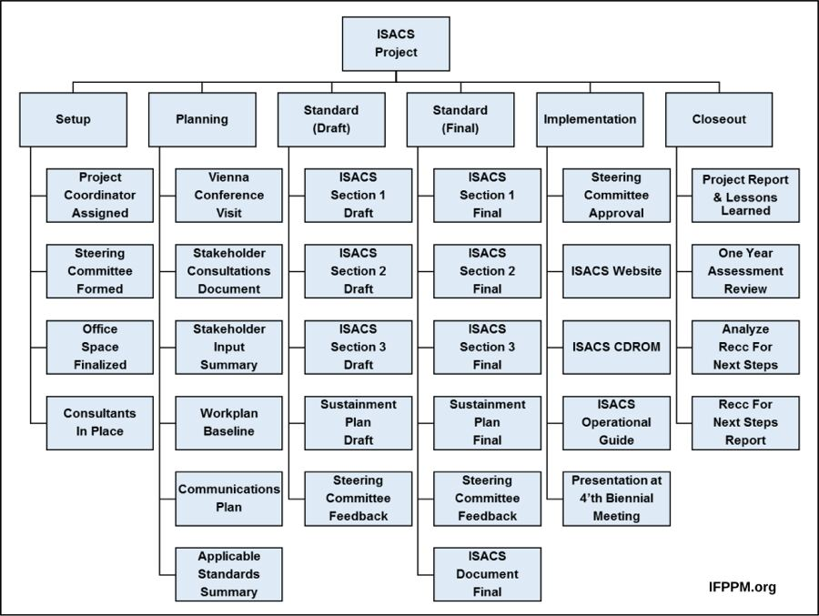

# Work Breakdown Structures

## What a WBS Does

A Work Breakdown Structure is a deliverable-oriented hierarchy that defines
the total approved project scope. It answers **what must exist**, not when the
work happens or in which sequence.

PMI describes the WBS as a hierarchical decomposition of project work into
increasingly detailed deliverables. The lowest controlled elements are work
packages. Activities, dependencies, estimates, resources, and schedules can be
developed from those work packages afterward.


*A WBS can be represented as an outline, an organisational tree, or another
hierarchical view; the scope relationships should remain the same.*

Source: [Project Management Institute: Developing and Elaborating Effective Work Breakdown Structures](https://www.pmi.org/learning/library/developing-elaborating-work-breakdown-structures-7241).

## The 100% Rule

The 100% rule says that the WBS contains all work within the approved project
scope and no work outside it. At every parent level, the child elements must
represent 100% of that parent's scope.

This is not a demand for perfect foresight. Teams can progressively elaborate
the WBS as uncertainty is resolved, while controlling changes to the approved
scope.

Use three tests at each branch:

1. **Complete:** Is any required deliverable missing?
2. **Non-overlapping:** Does the same scope appear under multiple branches?
3. **Verifiable:** Can the team recognize when this element is complete?

## A Practical Hierarchy

The number of levels depends on the project. A useful structure is:

```text
1.0 Project outcome
  1.1 Major deliverable
    1.1.1 Sub-deliverable
      1.1.1.1 Work package
```

Do not force `initiative -> epic -> user story -> task` into WBS levels. Those
backlog concepts serve a different purpose and may connect to selected work
packages later.



*This example shows how one project is decomposed into distinct branches and
progressively smaller elements.*

Source: [Practicalpm, Project Management - UN Project - Work Breakdown Structure](https://commons.wikimedia.org/wiki/File%3AProject_Management_-_UN_Project_-_Work_Breakdown_Structure_%28WBS%29.svg), licensed under [CC BY-SA 4.0](https://creativecommons.org/licenses/by-sa/4.0/).

## Stop at a Manageable Work Package

Decompose until a work package is clear enough to:

- assign one accountable owner;
- define completion and acceptance;
- estimate within a useful range;
- identify important dependencies and risks; and
- monitor without excessive overhead.

Avoid arbitrary rules such as a fixed number of levels or a universal maximum
duration. Higher-risk or poorly understood branches may need more detail than
stable, familiar work.

## Add a WBS Dictionary

The diagram alone rarely carries enough context. A WBS dictionary can record:

| Field | Purpose |
|---|---|
| WBS ID and name | Stable reference to the hierarchy. |
| Description | Scope included in the work package. |
| Completion evidence | What proves the deliverable is complete. |
| Owner | One accountable role, not necessarily the only contributor. |
| Dependencies | Inputs or decisions required from elsewhere. |
| Assumptions and exclusions | Boundaries that prevent silent scope growth. |
| Risks and open questions | Uncertainty requiring attention. |

## WBS, Dependency Map, and Schedule

These views answer different questions:

| Artifact | Question |
|---|---|
| WBS | What is included in the project scope? |
| Dependency map | What relies on what? |
| Responsibility map | Who is accountable or involved? |
| Estimate | How much effort or cost might be required? |
| Schedule | In what sequence and by when will work occur? |

Create the WBS before pretending to know a detailed schedule. Hidden scope is a
common reason early estimates look precise and later become unreliable.

## Quality Review

Review a WBS from the bottom up and top down:

- Can every work package be traced to a parent deliverable and project outcome?
- Are functional and non-functional requirements covered?
- Are evaluation, operations, compliance, rollout, and project-management
  deliverables present where relevant?
- Are branches mutually exclusive enough to avoid double counting?
- Are exclusions explicit?
- Could another team understand what completion means?

## Check Your Understanding

1. Why is a WBS not a schedule?
2. What does the 100% rule prevent?
3. When should decomposition stop?

<details>
<summary>Show solution</summary>

1. It defines scope and deliverable relationships, not sequence or dates.
2. It helps prevent missing scope, duplicated scope, and work outside the
   approved boundary.
3. Stop when the work package can be owned, verified, estimated, and monitored
   at a useful level of control.

</details>

## References

- [PMI: Developing and Elaborating Effective WBS](https://www.pmi.org/learning/library/developing-elaborating-work-breakdown-structures-7241)
- [PMI: Creating Effective Work Breakdown Structures](https://www.pmi.org/learning/library/creating-effective-wbs-recognize-quality-7541)
