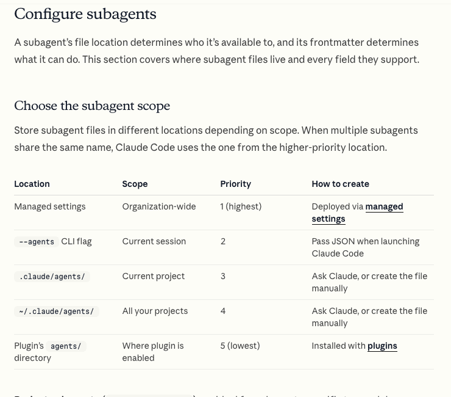
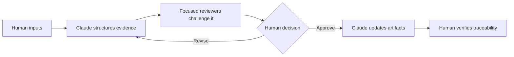

# Claude Code as an Analysis Team

## Delegate Production, Keep Decision Ownership

Claude Code can turn scattered inputs into structured questions and artifacts.
It can also produce confident errors, invented internal facts, weak estimates,
and recommendations that reflect its prompt more than reality.

The AI Project Manager should delegate four kinds of work:

1. **Structure:** create matrices, logs, WBS outlines, and decision drafts.
2. **Research:** find relevant concepts and sources for unfamiliar domains.
3. **Challenge:** look for missing evidence, hidden scope, and contradictions.
4. **Revision:** update approved artifacts while preserving traceability.

The group retains responsibility for the decision, the evidence, and any
external action.

## Use Focused Perspectives

Ask Claude Code to create focused, read-only project subagents when independent
reviews would help. Possible roles include:

- **feasibility challenger:** checks unsupported claims, missing alternatives,
  hard gates, and weak confidence;
- **data and model reviewer:** examines data readiness, baselines, evaluation,
  monitoring, and non-AI alternatives;
- **operations and security reviewer:** checks ownership, integration, support,
  access, incidents, and lifecycle concerns;
- **WBS auditor:** applies the 100% rule, looks for overlap, and checks that
  work packages are verifiable.

Choose only the perspectives relevant to the project. A subagent is a simulated
reviewer, not a qualified legal, security, financial, or domain authority.

*Project subagents can be stored with the repository and restricted to the
read-only tools needed for review.*

Source: [Claude Code Docs: Choose the subagent scope](https://code.claude.com/docs/en/sub-agents#choose-the-subagent-scope).

## Build an Evidence Boundary

Before analysis, tell Claude to classify each claim as:

- supplied and verified evidence;
- externally sourced evidence with a link;
- estimate with method and range;
- assumption requiring validation;
- unresolved question; or
- agent suggestion.

Prohibit the agent from silently upgrading one category into another. A
simulated engineer can suggest that latency may be difficult; only a specialist
review, prototype, benchmark, or comparable system can validate the claim.

## Use Approval Gates

Require approval before Claude:

- selects the preferred option;
- assigns a feasibility rating;
- converts an assumption into a fact;
- excludes a major deliverable;
- treats an estimate as a commitment; or
- writes the final recommendation.

## Ask Better Questions

Weak request:

> Tell us whether this AI product is feasible and create its project plan.

Stronger request:

> Read the approved project brief. Build a feasibility matrix without deciding
> the outcome. Separate evidence, estimates, assumptions, constraints, and
> unknowns. Include business as usual and one simpler alternative. Identify
> hard gates and the smallest validation action for each critical unknown. Wait
> for approval before drafting a recommendation.

The stronger request defines boundaries, alternatives, evidence standards, and
an approval gate.

## Review the Agent, Not Only the Artifact

Record at least one example where the group:

- corrected a fabricated or unsupported claim;
- rejected an unnecessary deliverable;
- added missing operational or governance scope;
- changed the recommendation after stronger evidence; or
- narrowed an overconfident estimate into a range and validation plan.

This is evidence of active AI Project Management, not a failure of the tool.

## Check Your Understanding

1. Why should feasibility reviewers usually be read-only?
2. Can agreement between several subagents validate an internal assumption?
3. Which decisions should remain approval gates?

Show solution

1. Their role is to challenge and report findings without silently changing the
   evidence or approved scope.
2. No. They may repeat the same unsupported premise. Validation requires an
   appropriate real source, expert, test, or measurement.
3. Option selection, feasibility ratings, important scope exclusions, estimate
   commitments, and the final recommendation require human ownership.

## References

- [Claude Code Docs: Create custom subagents](https://code.claude.com/docs/en/sub-agents)
- [Claude Code Docs: Common workflows](https://code.claude.com/docs/en/common-workflows)
