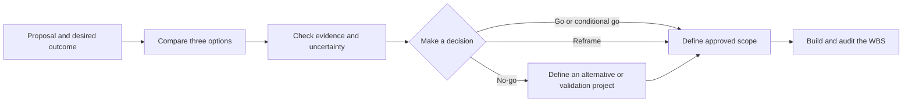
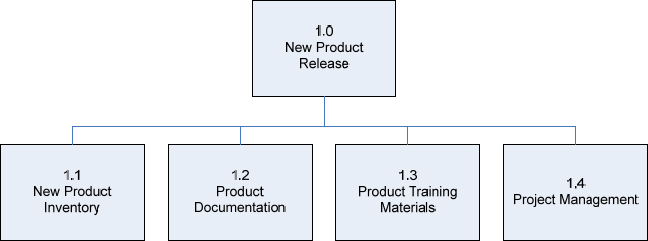

# Session Handout: Feasibility Decision and Work Breakdown

## Your Assignment

Choose one AI, data, software, or internal-service proposal. Your group must:

1. decide whether and how the proposal should proceed; and
2. describe all the project deliverables required for the recommended option.

**You are not expected to build the application.** You are producing an
evidence-based project decision and a Work Breakdown Structure (WBS), not a
working product, implementation plan, schedule, or backlog of user stories.

Claude Code should produce most of the first drafts. Your group acts as the AI
Project Manager: you provide context, question the analysis, verify evidence,
make the decisions, and approve the final scope.

## What You Must Deliver

Your completed repository must contain the following seven files. You may ask
Claude Code to create them, but your group remains responsible for their
content.

| File | What it answers | Minimum expected content |
|---|---|---|
| `project-brief.md` | What decision are we making? | Problem, users, desired outcome, three options, constraints, criteria, stakeholders, and exclusions |
| `assumptions-and-evidence.md` | What do we know, and how do we know it? | Important claims classified as evidence, estimates, assumptions, constraints, risks, or unknowns, with sources and validation actions |
| `feasibility-matrix.md` | Which option appears most feasible? | Comparison of business as usual, a simpler alternative, and the proposed option across the relevant feasibility dimensions |
| `decision-memo.md` | What should happen next, and why? | A `go`, `conditional go`, `reframe`, or `no-go` recommendation supported by evidence |
| `wbs.md` | What complete scope would the recommended direction require? | A hierarchy of deliverables and verifiable work packages |
| `wbs-dictionary.md` | What does each important work package include? | Scope, completion evidence, owner, dependencies, assumptions, exclusions, and open questions |
| `ai-collaboration-log.md` | How did the group supervise Claude? | Examples of Claude's work that the group accepted, corrected, or rejected, with reasons |

Focused Claude Code subagents under `.claude/agents/` are useful when the
proposal benefits from independent reviews, but do not create roles that have
no meaningful work.

## Example of the Expected Journey

Imagine that a group proposes an AI assistant that answers employees' HR
questions. This is only an example; choose a different challenge.

1. The group defines the desired outcome, such as reducing repetitive HR
   requests while keeping answers reliable and private.
2. It compares continuing with the current process, improving the existing FAQ,
   and building the AI assistant.
3. It investigates data availability, answer quality, privacy, integration,
   operating cost, ownership, and adoption.
4. It discovers that sensitive-data handling has not been validated, so it
   recommends a **conditional go** subject to a privacy review and a bounded
   test.
5. It creates a WBS covering the approved direction: requirements, knowledge
   preparation, evaluation, interface, access controls, monitoring, rollout,
   support, and project governance.

The group does not build the assistant. Its result is a defensible decision and
a complete description of the work that would follow.



*The feasibility decision comes before the WBS. The group must first decide
which direction is justified, then describe the scope of that direction.*

## Ground Rules

- Claude Code creates and edits the project files; the group reviews the work.
- The group approves the options, decision criteria, ratings, exclusions, final
  recommendation, and WBS.
- Every important claim must have a source or be labelled as an estimate,
  assumption, constraint, risk, or unknown.
- Public web research may support general claims, but it cannot invent internal
  facts such as the budget, available skills, data quality, system performance,
  or stakeholder approval.
- Claude personas and subagents are simulated perspectives, not real experts.
- Do not enter confidential, personal, or commercially sensitive information.
- Claude must show proposed changes before applying a major decision or scope
  revision.
- Estimates must use ranges and explain their basis. They are not commitments.

## Step 1: Choose and Frame the Proposal

Choose a proposal that:

- targets a recognizable user or business outcome;
- has meaningful uncertainty about data, technology, operations, cost,
  adoption, compliance, or safety;
- has at least one credible simpler alternative; and
- can be discussed without exposing sensitive information.

Different groups should choose different proposals. A project that is obviously
feasible offers little to investigate, and a decision not to build is a valid
outcome.

Open the project with Claude Code using any available interface, such as the VS
Code extension, CLI, desktop application, or another graphical interface.

Ask Claude to read the lesson files and interview the group before drafting
`project-brief.md`. Do not ask for a recommendation yet.

The brief must define:

- the users and their current problem;
- the measurable user or business outcome;
- **Option A:** business as usual;
- **Option B:** a simpler way to improve the situation;
- **Option C:** the original proposal;
- known constraints and decision criteria;
- stakeholders who must validate important claims; and
- what this analysis deliberately excludes.

**The step is complete when:** someone unfamiliar with the proposal can explain
the problem, the desired outcome, the three options, and the decision to be
made. A feature name alone, such as "build a chatbot," is not an outcome.

## Step 2: Separate Evidence from Assumptions

Ask Claude to create `assumptions-and-evidence.md`. Review every important claim
and classify it as one of the following:

- **evidence:** supported by a reliable internal or external source;
- **estimate:** an approximate value with a stated method and range;
- **assumption:** believed to be true but not yet verified;
- **constraint:** a boundary the project must respect;
- **risk:** an uncertain event that could affect the project; or
- **unknown:** information the group does not currently have.

Add a direct source link for external evidence. For every critical assumption
or unknown, define the smallest credible validation action, such as a
stakeholder question, data profile, legal review, architecture experiment,
vendor demonstration, cost estimate, or user test.

**The step is complete when:** no important unsupported claim is written as a
fact, and every critical unknown has a practical way to investigate it.

## Step 3: Compare the Three Options

Copy [the feasibility matrix template](templates/feasibility-matrix.md) into the
project root as `feasibility-matrix.md`. Ask Claude to assess all three options
across the dimensions that matter for your proposal.

Possible dimensions include:

- user and strategic value;
- economic viability;
- technical feasibility;
- data and model readiness;
- operational ownership and support;
- legal, privacy, security, and safety;
- skills, resources, and dependencies; and
- adoption and sustainability.

For each important assessment, include the evidence, assumptions or unknowns,
confidence level, and next validation action. Identify any **hard gate**: a
condition that must be satisfied before the project can proceed. For example,
an unlawful, unsafe, or unmaintainable option cannot be rescued by a high total
score.

**The step is complete when:** the matrix compares the same three options using
the same relevant criteria and makes uncertainty visible. It must not simply
justify the group's original preference.

## Step 4: Challenge the Analysis

Use [05 - Claude Code as an Analysis Team](05-claude-code-as-analysis-team.md)
and the [official subagent documentation](https://code.claude.com/docs/en/sub-agents).

Choose only the review perspectives that are relevant. Examples include a
feasibility challenger, data and model reviewer, operations and security
reviewer, or WBS auditor. Ask reviewers to report findings without editing the
approved files.

For each material finding, the group must choose one response:

- accept it because it is supported;
- turn it into an assumption or open question;
- request stronger evidence; or
- reject it and record the reason.

Begin `ai-collaboration-log.md` and record these decisions. A short table is
enough:

| Claude contribution | Accepted, corrected, or rejected? | Evidence or reason |
|---|---|---|
|  |  |  |

**The step is complete when:** the group has challenged the analysis and has
recorded at least one meaningful correction, rejection, or request for stronger
evidence.

## Step 5: Make the Decision

Ask Claude to draft four short arguments based on the same evidence:

- **Go:** proceed with the proposed option.
- **Conditional go:** proceed only if specified conditions are met.
- **Reframe:** change the proposal or choose the simpler alternative.
- **No-go:** stop because the proposal is not currently justified.

Compare the arguments and let the group make the final decision. Copy
[the decision memo template](templates/decision-memo.md) into the project root
as `decision-memo.md` and complete it with:

- the options considered;
- the recommendation and its reasoning;
- the strongest supporting evidence;
- critical assumptions, unknowns, conditions, and hard gates;
- important trade-offs;
- confidence and limitations; and
- the next action resulting from the decision.

If the decision is `no-go`, choose either a feasible alternative or a small
validation project for the WBS. Do not plan the delivery of a product that the
group recommends abandoning.

**The step is complete when:** another group could read only the decision memo
and understand what was decided, why, how confident the group is, and what must
happen next.

## Step 6: Define the Approved Deliverables

Only now should the group define project scope. Ask Claude to propose the major
deliverables needed for the approved, conditional, reframed, or validation
direction.

Review whether the proposed scope covers everything relevant to that direction:

- product and user requirements;
- data, evaluation, and technical components;
- non-functional requirements such as performance and accessibility;
- operations, ownership, support, and monitoring;
- security, privacy, legal, and safety evidence;
- rollout, migration, fallback, and retirement; and
- project governance and decision records.

Remove anything that does not contribute to the approved direction. Add missing
deliverables and keep exclusions explicit.

**The step is complete when:** every major feasibility condition and approved
requirement is represented by at least one deliverable, without adding rejected
scope.

## Step 7: Build the WBS

Ask Claude to create `wbs.md` as a numbered hierarchy or Mermaid diagram. The
upper levels should use **deliverable nouns**, not vague activities.



*The same WBS can be displayed as an outline, a tree, or another hierarchy. Use
this figure to understand the parent-child structure, not as content to copy
into your own project.*

Source: [Project Management Institute: Developing and Elaborating Effective Work Breakdown Structures](https://www.pmi.org/learning/library/developing-elaborating-work-breakdown-structures-7241).

For example:

```text
1.0 Employee support service
  1.1 Approved knowledge base
  1.2 Evaluated answer service
  1.3 Secure employee interface
  1.4 Monitoring and support model
  1.5 Controlled rollout
```

Decompose each major deliverable into work packages that are bounded, ownable,
and verifiable. A WBS describes **what must exist**, not the order in which
people will work. Do not turn it into a schedule, task list, or user-story
backlog.

Copy [the WBS dictionary template](templates/wbs-dictionary.md) into the project
root as `wbs-dictionary.md`. Document the most important or uncertain work
packages with their scope, completion evidence, owner, dependencies,
assumptions, exclusions, risks, and open questions.

Apply the 100% rule branch by branch:

1. Do the children contain all the scope represented by their parent?
2. Does the same work appear under more than one branch?
3. Is every work package bounded, ownable, and verifiable?
4. Can requirements and feasibility conditions be traced to the WBS?
5. Are assumptions, dependencies, and exclusions explicit?

**The step is complete when:** the WBS covers all approved project scope, no
work is duplicated, and a reviewer can tell how each important work package
will be considered complete.

## Step 8: Perform the Final Audit

Ask Claude or a read-only WBS auditor to review the complete repository and
report findings without changing files. The group must verify that:

- the recommendation follows from the feasibility matrix;
- unsupported claims are not presented as facts;
- critical unknowns have validation actions;
- the WBS represents the recommended direction rather than automatically
  representing the original idea;
- the WBS covers all approved scope without duplication;
- feasibility conditions and requirements can be traced to work packages; and
- the next decision, experiment, or delivery step is clear.

Apply only the corrections the group approves. Finish
`ai-collaboration-log.md` with the important Claude contributions that were
accepted, corrected, or rejected.

**The step is complete when:** all seven required files are consistent with one
another and the group can defend both its decision and its project scope.

## Final Submission Checklist

- [ ] We chose a clear proposal and defined an outcome, not only a feature.
- [ ] We compared business as usual, a simpler alternative, and the proposed
      option.
- [ ] We separated evidence, estimates, assumptions, constraints, risks, and
      unknowns.
- [ ] We added sources for important external claims.
- [ ] We identified hard gates and validation actions for critical unknowns.
- [ ] We made an explicit `go`, `conditional go`, `reframe`, or `no-go`
      recommendation.
- [ ] Our WBS describes the recommended direction and covers 100% of its
      approved scope.
- [ ] Our work packages are bounded and have observable completion evidence.
- [ ] We recorded at least one meaningful Claude contribution that we corrected
      or rejected.
- [ ] We did not include sensitive information.
- [ ] All seven required files are present and consistent.

## Optional Extensions

Start optional work only after the core decision memo and WBS pass the final
audit. Choose extensions that reduce a real uncertainty or make the approved
scope more actionable.

### Compare Costs and Benefits

Build a lightweight lifecycle cost model for the leading options. Include
setup, integration, data preparation, vendor or compute usage, monitoring,
support, change, and retirement. Use ranges and test how the recommendation
changes when major assumptions vary.

### Design a Validation Project

Turn the most important unknown into a bounded proof of feasibility. Define the
question, evidence, acceptance threshold, owner, required inputs, and stop
condition. Create a separate WBS for this validation project.

### Map Dependencies and Sequence

Create a dependency map from the approved work packages. Identify external
dependencies, decision gates, possible parallel work, and the assumptions most
likely to change the sequence. Keep this separate from the WBS.

### Create a Risk and Control Register

For the most material risks, record cause, event, impact, likelihood, severity,
preventive controls, response, owner, trigger, and residual risk. Check that
every approved response maps to work in the WBS.

### Define an MVP and Later Releases

Use evidence and feasibility conditions to identify the smallest release that
can deliver value safely. Show which WBS elements belong to the first release,
which are deferred, and which cannot be deferred because they are enabling,
operational, legal, or safety requirements.

### Convert Work Packages into GitHub Issues

Ask Claude Code to propose issues for selected work packages. Each issue should
include the WBS ID, outcome, scope, completion evidence, dependencies, and open
questions. Review the proposed issue set before allowing Claude to create or
edit anything on GitHub.

### Reassess After New Evidence

Introduce one meaningful evidence change, such as a missing dataset, lower
budget, vendor restriction, stronger model result, regulatory constraint, or
user finding. Ask Claude to identify which matrix entries, decision conditions,
and WBS branches are affected. Approve only traceable changes.

## Reflection

- Which feasibility dimension changed the proposal most?
- Which claim looked convincing until its evidence was checked?
- What hidden scope appeared only during WBS creation?
- Where did Claude add false certainty?
- What should be validated before anyone produces a detailed estimate?
