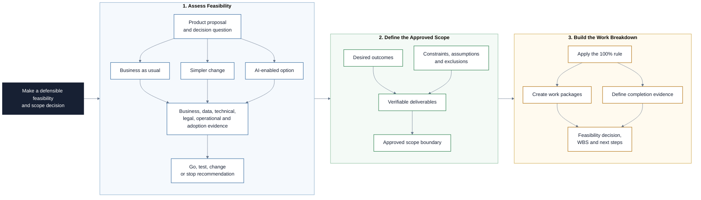

# Feasibility Analysis and Work Breakdown

This repository is a Markdown-based learning path for deciding whether an AI
or data product should proceed and, when it should, defining the complete scope
of work. Participants compare options, test assumptions across business,
technical, data, legal, operational, and safety dimensions, then turn an
evidence-based decision into a deliverable-oriented Work Breakdown Structure
(WBS). Claude Code supports research, critique, and artifact production while
the AI Project Manager remains accountable for evidence and decisions.

## Project at a Glance

The project first decides whether and how a proposal should proceed, then turns
the approved direction into a complete deliverable-oriented work breakdown.

## Learning Objectives

By the end of this repository, you should be able to:

- Explain when a feasibility analysis creates useful decision value.
- Compare a proposed solution with simpler alternatives and business as usual.
- Assess strategic, economic, technical, operational, legal, and scheduling
  feasibility using evidence and explicit confidence levels.
- Evaluate data, model, safety, fairness, privacy, and sustainability concerns
  for an AI or data product.
- Distinguish facts, estimates, assumptions, constraints, risks, and unknowns.
- Recommend `go`, `conditional go`, `reframe`, or `no-go` with clear reasoning.
- Separate outcomes, deliverables, requirements, work packages, activities, and
  milestones.
- Build and review a deliverable-oriented WBS using the 100% rule.
- Use Claude Code and focused subagents to challenge feasibility and scope
  without treating simulated expertise as validated evidence.
- Produce a concise decision memo and a traceable project breakdown.

## Learning Path

The modules build on each other in order.

| File / Folder | Description |
|---|---|
| [**01 - Feasibility as a Decision**](01-feasibility-as-a-decision.md) | Frame the decision, compare options, and make uncertainty visible before committing resources. |
| [**02 - AI and Data Product Feasibility**](02-ai-and-data-product-feasibility.md) | Assess data, model, infrastructure, operations, safety, legal, adoption, and sustainability concerns. |
| [**03 - From Outcomes to Deliverables**](03-from-outcomes-to-deliverables.md) | Translate an approved direction into deliverables and requirements without confusing value, scope, and activity. |
| [**04 - Work Breakdown Structures**](04-work-breakdown-structures.md) | Decompose total project scope into verifiable deliverables and work packages using the 100% rule. |
| [**05 - Claude Code as an Analysis Team**](05-claude-code-as-analysis-team.md) | Delegate research and critique while preserving evidence quality, human approval, and decision ownership. |
| [**06 - Session Handout**](06-session-handout.md) | Choose an original product proposal, assess its feasibility, make a recommendation, and build the corresponding WBS. |

### Additional Folders and Files

| File / Folder | Description |
|---|---|
| [**assets**](assets/) | Local, attributed figures from official guidance, professional associations, and Wikimedia Commons. |
| [**templates**](templates/) | Starting structures for the feasibility matrix, decision memo, and WBS dictionary. |

## Getting Started

No Python environment is required for this repository.

1. Create a repository from this template and add collaborators when working
   in a group.
2. Clone the repository and open it locally.
3. Read the lesson files in numerical order.
4. Use Claude Code through any available interface and make the project files
   available to it when the handout introduces the analysis workflow.
5. Use the session handout to produce the project artifacts.

## AI Collaboration Guidelines

AI can propose questions, organize evidence, research technical concepts, find
gaps, and draft artifacts. It cannot confirm internal facts, provide binding
legal advice, estimate unknown work with certainty, or approve a project. Do not
enter sensitive data. Record sources, mark assumptions, and keep a short log of
what the group accepted, corrected, or rejected.

## References & Further Reading

- [HM Treasury: The Green Book 2026](https://www.gov.uk/government/publications/the-green-book-appraisal-and-evaluation-in-central-government/the-green-book-2026): proportionate options appraisal, uncertainty, business as usual, and the Five Case Model.
- [PMI: Developing and Elaborating Effective Work Breakdown Structures](https://www.pmi.org/learning/library/developing-elaborating-work-breakdown-structures-7241): deliverable orientation, work packages, and the 100% rule.
- [NIST: AI Risk Management Framework Core](https://airc.nist.gov/airmf-resources/airmf/5-sec-core/): govern, map, measure, and manage AI risks across the lifecycle.
- [NIST: AI RMF Generative AI Profile](https://www.nist.gov/publications/artificial-intelligence-risk-management-framework-generative-artificial-intelligence): risk guidance for generative AI systems.
- [European Commission: AI Act](https://digital-strategy.ec.europa.eu/en/policies/regulatory-framework-ai): official overview of the EU risk-based regulatory framework.
- [Claude Code: Create custom subagents](https://code.claude.com/docs/en/sub-agents): official guide to focused subagents, scope, and tool permissions.
