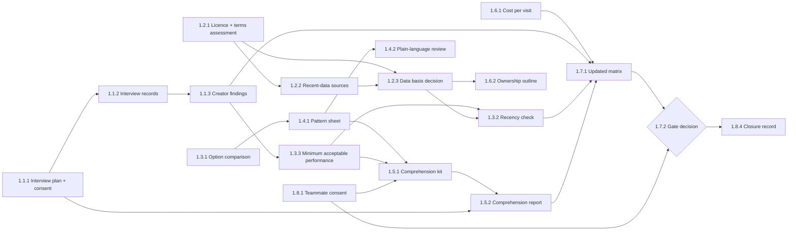

# Dependency Map (optional extension)

**Reference date:** 2026-11-27 · Kept separate from the WBS on purpose: the WBS says **what** exists, this map says
**what relies on what**. No dates, no durations.

## What this shows

| Question | Answer |
|---|---|
| External dependencies | A legal reviewer (1.2.1), creators (1.1, 1.5), the two teammates (1.8.1), any recent-data provider (1.2.2) |
| Decision gates | 1.3.3 thresholds must be approved **before** 1.3.2 runs; 1.7.2 is the project's single exit gate |
| Can start at once, in parallel | 1.1.1 interview plan, 1.2.1 legal reading, 1.3.1 comparison (partly done), 1.6.1 cost measurement, 1.8.1 consent |
| Longest chain | 1.1.1 → 1.1.2 → 1.1.3 → 1.3.3 → 1.3.2 → 1.7.1 → 1.7.2 |
| Assumptions most likely to change the sequence | A01 (if no creator wants odds, 1.3.2 and 1.6 lose their purpose); U05 (if no lawful recent data exists, 1.3.2 ends early as "not possible"); A07 (a "no" removes the C mock from 1.5.1) |
