# Work Breakdown Structure: Launch Check Validation Project

**Reference date:** 2026-11-27 · Draft by Claude, **scope awaits owner approval**.
This WBS describes the **reframed direction** from `decision-memo.md`, not the original idea (C). It says **what must
exist** at the end, not in which order or by when. Details per work package: `wbs-dictionary.md`.

## Scope Boundary

**In scope:** everything needed to reach a well-founded gate decision (publish B, proceed to C under conditions, or
stop): creator evidence, the legal and data basis, evidence on estimate quality, the pattern sheet as a research
probe, comprehension evidence, a cost and operations outline, the gate package, and project governance.

**Out of scope (explicit exclusions):** publishing or hosting anything; building the public Launch Check Online
page (C); new model training; scraping Kickstarter; commercial use or pricing; a what-if optimizer; other platforms;
a schedule, a backlog or a detailed cost estimate. A decision to publish B or to build C starts a **new** scope
with its own WBS.

## Hierarchy

```text
1.0 Launch Check validation project
  1.1 Creator evidence
    1.1.1 Interview plan and consent pack
    1.1.2 Anonymised interview record set
    1.1.3 Creator findings report
  1.2 Legal and data basis
    1.2.1 Licence, platform-terms and AI Act assessment
    1.2.2 Recent-data source assessment
    1.2.3 Data basis decision record
  1.3 Estimate quality evidence
    1.3.1 Option comparison report (B tables vs C model)
    1.3.2 Recency check report
    1.3.3 Minimum acceptable performance definition
  1.4 Pattern sheet probe (Option B)
    1.4.1 Pattern sheet content
    1.4.2 Plain-language and accessibility review record
  1.5 Comprehension evidence
    1.5.1 Comprehension test kit
    1.5.2 Comprehension test report
  1.6 Release readiness outline
    1.6.1 Cost-per-visit measurement report
    1.6.2 Ownership, support and retirement outline
  1.7 Gate decision package
    1.7.1 Updated feasibility matrix and assumptions register
    1.7.2 Gate decision memo
  1.8 Project governance
    1.8.1 Teammate consent record
    1.8.2 Decision and change log
    1.8.3 AI collaboration log
    1.8.4 Project closure record
```

```mermaid
flowchart TB
    P["1.0 Launch Check validation project"]
    P --> E["1.1 Creator evidence"]
    P --> L["1.2 Legal and data basis"]
    P --> Q["1.3 Estimate quality evidence"]
    P --> B["1.4 Pattern sheet probe"]
    P --> C["1.5 Comprehension evidence"]
    P --> R["1.6 Release readiness outline"]
    P --> G["1.7 Gate decision package"]
    P --> M["1.8 Project governance"]
    E --> E1["1.1.1 Interview plan and consent pack"]
    E --> E2["1.1.2 Anonymised interview records"]
    E --> E3["1.1.3 Creator findings report"]
    L --> L1["1.2.1 Licence, terms, AI Act assessment"]
    L --> L2["1.2.2 Recent-data source assessment"]
    L --> L3["1.2.3 Data basis decision record"]
    Q --> Q1["1.3.1 Option comparison report"]
    Q --> Q2["1.3.2 Recency check report"]
    Q --> Q3["1.3.3 Minimum acceptable performance"]
    B --> B1["1.4.1 Pattern sheet content"]
    B --> B2["1.4.2 Plain-language review record"]
    C --> C1["1.5.1 Comprehension test kit"]
    C --> C2["1.5.2 Comprehension test report"]
    R --> R1["1.6.1 Cost-per-visit report"]
    R --> R2["1.6.2 Ownership and retirement outline"]
    G --> G1["1.7.1 Updated matrix and register"]
    G --> G2["1.7.2 Gate decision memo"]
    M --> M1["1.8.1 Teammate consent record"]
    M --> M2["1.8.2 Decision and change log"]
    M --> M3["1.8.3 AI collaboration log"]
    M --> M4["1.8.4 Project closure record"]
```



8 deliverables, 21 work packages. All are nouns (things that will exist), not activities.

## Traceability: Conditions and Requirements to Work Packages

| Condition, gate or requirement | Source | Covered by |
|---|---|---|
| Creators want pre-launch odds (A01, A02) | Critical condition 3 | 1.1.1, 1.1.2, 1.1.3 |
| G1 lawful use (U03, A06) | Hard gate | 1.2.1, 1.2.3 |
| G2 currency: lawful recent data and recency check (U02, U05) | Hard gate for C | 1.2.2, 1.3.2 |
| G2 for B: the "2009 to 2018" label is understood (A04) | Hard gate for B | 1.4.1, 1.5.1, 1.5.2 |
| G3 cost measured and approved (C02) | Hard gate | 1.6.1 |
| G4 nothing typed is stored (C03) | Hard gate for C | 1.6.2 (design rule), 1.7.2 (checked at gate) |
| Minimum acceptable performance (U08) | Lesson 02 | 1.3.3 |
| Creators read the band at least as well as the sheet (U06) | Condition 5 | 1.5.1, 1.5.2 |
| Teammate consent (A07) | Condition 6 | 1.8.1 |
| Interview data protected (C06) | Constraint | 1.1.1, 1.1.2, 1.8.4 |
| No what-if optimizer (C05) | Constraint | 1.4.1 (patterns written as patterns), 1.5.1 (C mock has no what-if) |
| Option quality compared on the same data (E09) | Evidence to keep current | 1.3.1 |
| Decision recorded and defensible | Handout Step 5 | 1.7.1, 1.7.2, 1.8.2 |
| Supervision of Claude recorded | Handout Step 4 | 1.8.3 |

Every gate and condition in `feasibility-matrix.md` appears at least once. No work package exists only for the
rejected scope (C build).

## 100% Rule Audit (branch by branch)

| Branch | 1. Children = all parent scope? | 2. Overlap? | 3. Bounded, ownable, verifiable? | 4. Traceable? | 5. Assumptions explicit? |
|---|---|---|---|---|---|
| 1.1 Creator evidence | Plan, raw records, findings: complete | No | Yes; completion = signed-off report | A01, A02 | N01 range stated |
| 1.2 Legal and data basis | Licence and terms, data sources, the decision: complete | 1.2.3 records the decision, 1.7.2 the gate: different decisions | Yes | G1, G2 | Legal reading is external (dependency) |
| 1.3 Estimate quality | Comparison, recency, threshold: complete | 1.3.1 vs 1.3.2: same method, different data window | Yes | E09, U02, U08 | 1.3.2 may end as "not possible" (allowed outcome) |
| 1.4 Pattern sheet probe | Content and its review: complete | Not with 1.5 (1.5 tests it, 1.4 makes it) | Yes | G2 for B | Probe only; publishing excluded |
| 1.5 Comprehension | Kit and report: complete | No | Yes | U06 | Threshold comes from 1.3.3 |
| 1.6 Release readiness | Cost and ownership: complete for a gate decision | No | Yes | G3, G4 | Outline only; hosting excluded |
| 1.7 Gate package | Inputs refreshed + decision: complete | 1.7.1 updates files that already exist (no second matrix) | Yes | All gates | Decision rules from `decision-memo.md` |
| 1.8 Governance | Consent, logs, closure: complete | 1.8.2 (decisions) vs 1.8.3 (AI supervision): different content | Yes | A07, C06 | - |

## Optional Views

- What goes first and what can wait: `release-cut.md`
- What depends on what (kept separate from the WBS on purpose): `dependency-map.md`
- Risks and their controls, mapped to work packages: `risk-register.md`
